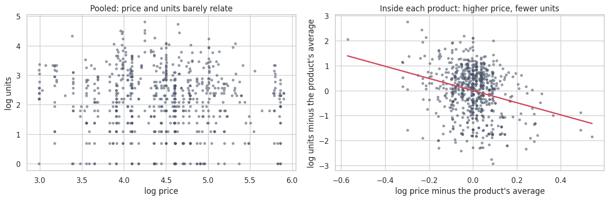
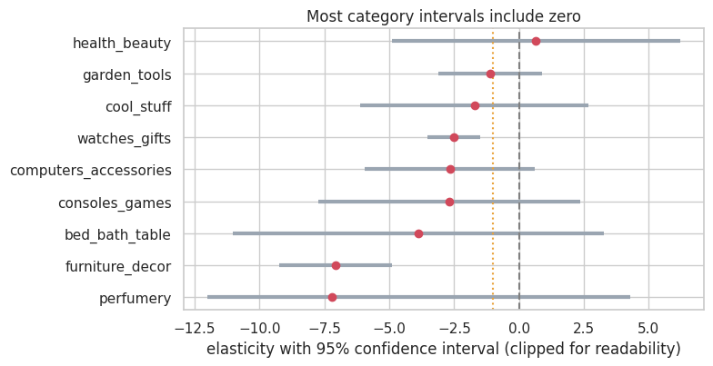
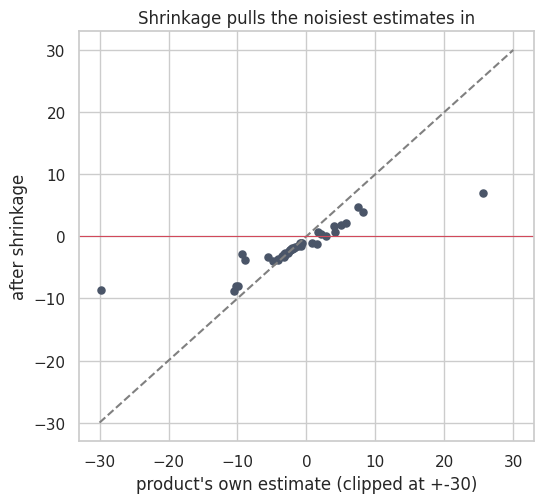

# Price elasticity and pricing: what can 676 product-months tell us?

How much do the units sold of a product change when its price changes, and what does that allow us to say about pricing decisions?
The analysis uses the **Retail Price Optimization** case-study dataset: **52 products, 9 categories, 20 months (2017-2018), 676 product-month rows**.

## Main results

| Finding | Result |
|---|---|
| **Naive elasticity** (all products pooled) | **-0.13** (R-squared 0.01): almost no relation, because expensive and cheap products are being compared with each other |
| **Within-product elasticity** (product fixed effects) | **-2.44**, 95 % CI [-3.23, -1.64]: a 1 % higher price goes with about 2.4 % fewer units |
| Robustness: + month, holidays, product score / + month-by-month effects and competitor-relative price | -2.57 / -2.61 |
| By category | Only 2 of 9 intervals exclude zero (furniture_decor -7.1, watches_gifts -2.5) |
| By product | 42 products can be estimated; 12 are significant, **3 of them with the wrong (positive) sign**; the typical 95 % interval is about 12 points wide |
| Do products really differ? | Yes: heterogeneity test p < 0.001, I-squared 74 %. Yet after shrinkage, the extreme -29.8 becomes -8.6 |
| Does price improve next-month predictions? | **No:** best model with price 0.954 vs 0.956 for each product's own average (MAE of log units, ~120 test rows) |
| Order of magnitude | If the average elasticity were causal, a 10 % price cut goes with about **+7 % to +27 %** revenue and a 10 % rise with **-6 % to -19 %** |



On the left, mixing all products, price and units look unrelated. On the right, each product is compared with itself over time: a higher price goes with fewer units.





**What the analysis does not give:** an optimal price. Revenue is not profit and the data has no unit cost, only freight price.
For a constant elasticity *e* < -1 the profit-maximising price is `p* = c * e / (1 + e)` (a markup of `1 / (|e| - 1)` over the cost `c`), which needs a cost that is not in the data.
Product-level numbers are hypotheses to test with a price experiment, not measurements.

## Method

1. Check that each product's price actually moves (6 of 52 barely do), since elasticity needs variation.
2. Compare each product **with itself over time** (product fixed effects) instead of pooling all products. Standard errors are clustered by product.
3. Check that the estimate is stable across three specifications.
4. Estimate by category and by product, test the heterogeneity between products and apply partial pooling (shrinkage).
5. Test out of sample: train on the first 80 % of the months, predict the last 20 %.
6. Translate the elasticity into revenue scenarios, with the uncertainty.

## What I changed from my first version

The first version of this repository (its README is in the history) computed the elasticity of each product separately and used OLS to find optimal prices.
Looking at it again, I changed three things:

- **Per-product estimates from 5 to 20 months are too noisy** to read as exact numbers. They are now shown with their uncertainty, a heterogeneity test and shrinkage.
- **An optimal price cannot be computed without costs.** The notebook says so and gives revenue scenarios instead.
- **I added an out-of-sample test** and the comparison with the naive pooled estimate.

The original notebook was not preserved, so this is a rebuilt analysis of the same problem with the same type of data.

## Limitations

- Prices were not randomised: they moved with promotions, competitors and seasons, so the elasticity may be biased. Competitor prices and month effects reduce but do not remove this.
- 5 to 20 months per product is little, and a constant elasticity is a simplification.
- Customers is not used as a control because it is itself an outcome of price.
- The out-of-sample test has only about 120 rows: it is a warning, not a verdict.

## Run it

```bash
pip install -r requirements.txt
# put retail_price.csv in data/  (see data/README.md)
jupyter notebook Price_optimization.ipynb
```
